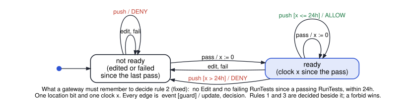

# cs3892-2026-10-20-symbolic-and-bounded-model-checking

Session 16. How a model checker actually decides a safety property. **Symbolic** model checking
stores sets of states as BDDs and computes the reachable set as a fixpoint; **bounded** model
checking asks a SAT/SMT solver about runs of at most *k* steps; **k-induction** turns bounded
queries into a proof for runs of every length. One running example from session 9 — the counter —
and session 9's add-2 counter, where the property is true but not inductive. Then, from Thursday,
a policy over an agent's history run by a real interpreter: Cedar for one request, Dogwood for the
events before it.

| File | Shows | Result | Tool |
|---|---|---|---|
| `python/bdd.py` | a reduced ordered BDD in about eighty lines, imported by the others | — | Python |
| `python/01_bdd_sets_of_states.py` | a set of states as a Boolean function; reduction; canonicity; variable order | "x ≤ 10": 11 of 32 patterns, 7 nodes (the full tree has 63) · two formulas, one node · `a = b` on 4-bit registers: 14 nodes interleaved, 47 separated | Python |
| `python/02_symbolic_reachability.py` | `Reach_{k+1} = Reach_k ∪ Post(Reach_k)` on BDDs, with `Post` as image computation | fixpoint after 10 steps · `AG (x ≤ 10)` holds · `AG (x ≤ 9)` fails, first bad state in `Reach_10` | Python |
| `python/03_bmc_what_k_shows.py` | BMC with Z3 on a FALSE property | no counterexample at every k ≤ 9 · counterexample `0 → … → 10` at k = 10 | Z3 |
| `python/04_k_induction.py` | base and step queries; a CTI chain; strengthening; a finite range | add-2, `x ≠ 5`: step fails at every k (…, 1, 3, 5) · "x even" proves it at k = 1 · on 0..15 with wrap, k = 8 | Z3 |
| `smv/05_add2_finite.smv` | the finite add-2 counter in NuSMV, three ways | BDDs: true · k-induction k = 7: cannot prove · k = 8: true | NuSMV / nuXmv |
| `smv/06_counter_bmc.smv` | `NuSMV -bmc -bmc_length k` on the counter | bound 9: no counterexample for either · bound 10: `G (x ≤ 9)` false · BDDs: false, true | NuSMV / nuXmv |
| `python/dogwood_cli.py` | finds the `dogwood` command, or fetches the course's Linux build of v1.1 (checked by SHA-256), or compiles it | — | Python |
| `python/07_dogwood_coding_agent.py` | three rules for a coding agent in Cedar and Dogwood (`dogwood/`), replayed by Dogwood's own interpreter: a forbid, a `since`, a `count` | version 1 lets a push through after a failing test run (@720) · the fix (two `since`s) refuses it · force-pushes: allow ×3, deny, allow once one leaves the hour, deny · `lower`: each temporal condition becomes one context Boolean | Dogwood 1.1 |

Every SMV result was run under **NuSMV 2.6.0** and **nuXmv 2.2.0**; nuXmv's IC3
(`go_msat; check_invar_ic3`) also proves `05`, but nuXmv is not run in CI. The notebook asserts the
NuSMV results, and the Python files assert their own.

`07` runs the **real** Dogwood reference interpreter (AWS, Apache-2.0,
[github.com/dogwood-policy/dogwood](https://github.com/dogwood-policy/dogwood), tag v1.1), which its
authors say is not for production use. Compiling it takes a few minutes on Colab, so `dogwood_cli.py`
downloads an unmodified build of v1.1 that this repository publishes as a release, with its
LICENSE, NOTICE and build notes inside. The drawn machine is the monitor that rule 2 needs: one bit
and one clock.

