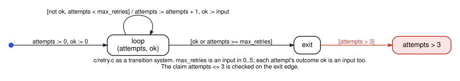
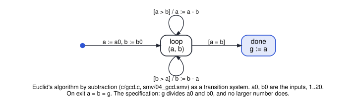

# cs3892-2026-10-27-bounded-model-checking-of-programs

Session 17. A C program is a transition system over its memory states: (the line it is at, the values
of its variables). **CBMC** unrolls each loop up to a bound, writes the unrolled program as one
formula (one copy of each variable per assignment), and asks a SAT solver for inputs that make an
assertion fail. That is session 16's bounded model checking, with the program itself as the model.

| File | Shows | Result | Tool |
|---|---|---|---|
| `python/cbmc_cli.py` | finds CBMC, or fetches the official 6.11.0 release (Ubuntu 22.04 package, SHA-256 checked) and unpacks it in Python: no root needed | — | Python |
| `c/counter.c`, `python/01_counter_in_c.py` | the running counter as a loop, checked for 30 steps | `x <= 10`: SUCCESS · the counter has no inputs, so CBMC settles it while unrolling | CBMC |
| `c/agent.c`, `python/02_agent_trace.py` | session 11's agent in C: the model's action and the human's answer are inputs | without a gateway: FAILURE, trace `action=2` with `approved=0` · `-DGATEWAY`: SUCCESS for 3 steps | CBMC |
| `c/retry.c`, `python/03_unwinding_assertions.py` | what an unwinding assertion protects you from; the formula CBMC builds (`--show-vcc`) | `--unwind 3 --no-unwinding-assertions`: SUCCESSFUL (wrong) · `--unwind 3`: unwinding assertion FAILURE · `--unwind 6`: the real counterexample, `max_retries` 4 or 5 | CBMC |
| `c/gcd.c`, `python/04_gcd.py` | Euclid's algorithm by subtraction, for every `a0, b0` in 1..20; a broken `gcd` that returns 1; a specification too weak to notice | full spec (`g` divides both, and no larger number does): SUCCESS at `--unwind 20` · `-DBROKEN`: "divides both" SUCCESS, "the greatest" FAILURE · `-DBROKEN -DWEAK`: SUCCESSFUL, and wrong · `--unwind 19`: unwinding assertion FAILURE on `a0 = 20, b0 = 1` | CBMC |
| `smv/04_gcd.smv` | the same loop in SMV, every input pair at once; `a0`, `b0` and the candidate divisor `d` are `FROZENVAR`s, so a property of `d` holds for every `d` | `F (a = b)` true · divides both: true · the greatest: true · `F (a = 1)` false (a pair with gcd > 1) | NuSMV 2.6 (nuXmv 2.2: the same) |

**Since CBMC 6, unwinding assertions are on by default.** `--unwinding-assertions` is accepted and
changes nothing; `--no-unwinding-assertions` turns them off. Older tutorials, and FMAIV's day 4
command, pass the flag explicitly.

The bounded and inductive checks on SMV models from the first half of the session are in the
session 16 folder (`03_bmc_what_k_shows.py`, `04_k_induction.py`, `06_counter_bmc.smv`,
`08_ic3_spacer.py`).
