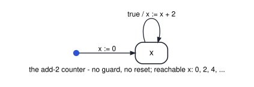
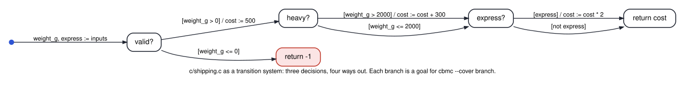
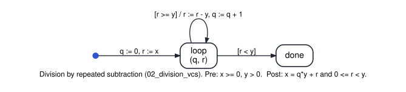
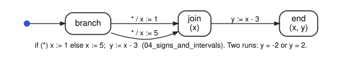
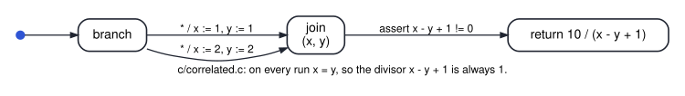
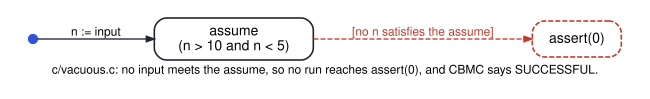
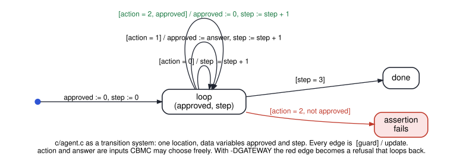

# cs3892-2026-10-29-loop-invariants-and-abstract-interpretation

Session 18. CBMC answers for runs up to a bound. Two ways past the bound. **Deductive
verification:** a loop invariant that is established, preserved and sufficient proves a loop for
every number of iterations. **Abstract interpretation:** compute over abstract values (signs,
intervals) rather than concrete ones. It always terminates (with widening), never misses a real
error (it is sound), and pays for both with false alarms. Plus two other uses of CBMC: generating
tests, and exposing vacuous specifications.

| File | Shows | Result | Tool |
|---|---|---|---|
| `python/cbmc_cli.py` | the same CBMC fetcher as session 17 | — | Python |
| `c/shipping.c`, `python/01_test_generation.py` | `cbmc --cover branch`: tests generated per branch, then run with gcc and checked against a model | 7 of 7 branch goals with 4 tests; every output matches | CBMC, gcc |
| `python/02_division_vcs.py` | division by repeated subtraction: the three loop conditions as Z3 queries | `r >= 0`: established, preserved, NOT sufficient · `x = q*y + r and r >= 0`: all three · variant `r` | Z3 |
| `c/add2_loop.c`, `python/03_loop_contract.py` | session 9's add-2 counter as a C loop, with a loop contract | `x != 5`: not preserved, counterexample 3 → 5 · `0 <= x <= 1000, x even`: SUCCESSFUL with no bound · no `decreases` clause, so partial correctness | CBMC |
| `python/absint.py` | a small abstract interpreter: signs, intervals, join, widening, a fixpoint at each loop head | — | Python |
| `python/04_signs_and_intervals.py` | the domains' arithmetic, and what a join loses | `+` plus `-` is top · `if (*) x := 1 else x := 5; y := x - 3`: signs say top, intervals `[-2, 2]` | Python |
| `python/05_widening.py` | the running counter: plain join, widening, one narrowing step | plain join: `[0, 10]` in 11 rounds (as session 16's BDD fixpoint) · widening: `[0, +inf]` · narrowing: `[0, 10]`, so `x <= 10` without a hand-written invariant | Python |
| `c/correlated.c`, `python/06_join_loses_correlation.py` | a false alarm from a non-relational domain; what a relational one keeps | intervals: `x - y + 1` in `[0, 2]`, alarm · `x - y` in `[0, 0]`: safe · goto-analyzer `--intervals` UNKNOWN, CBMC SUCCESS | Python, goto-analyzer, CBMC |
| `c/vacuous.c`, `python/07_vacuity.py` | three vacuous specifications and the check for each | `assume` nobody meets: SUCCESSFUL, `--cover assume` exposes it · unsatisfiable precondition · a postcondition true of every result | CBMC, Z3 |
| `c/agent.c`, `python/08_cbmc_inside.py` | inside CBMC, on session 11's agent: the GOTO program, the SSA equations, the SMT-LIB formula CBMC writes (`--smt2 --outfile`), and Z3's answer on that file | GOTO: the loop as `IF ¬(step < 3) THEN GOTO 5 … GOTO 1` · SMT-LIB: `QF_AUFBV`, 32-bit bit-vectors, 6 inputs as `declare-fun` · Z3: sat; the model's inputs, replayed, delete with `approved = 0` | CBMC, Z3 |

Frama-C and ACSL appear on the slides as notation only. Ubuntu's current package is a 2022 release
with no prover, so no Frama-C output is claimed or checked here. CBMC's loop contracts
(`__CPROVER_loop_invariant`) carry the same three conditions and are checked in CI.
