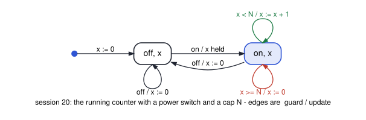

# cs3892-2026-11-05-lean-4-transition-systems

Session 20 (after D8). A transition system in Lean is a structure with an `init` and a `step`;
`Reachable` is an inductive predicate, so a fact about every reachable state is proved by
induction on how the state was reached. That is why an inductive invariant holds. Then session 9's
add-2 machine, where `x ≠ 5` is true but not inductive, and the stronger invariant that proves it;
the running counter with a power switch, proved for every cap `N`; and how to build a reachable
state, to show the bound is tight.

`TS`, `Reachable`, `InductiveInvariant`, `Invariant` and `inductive_invariant_holds` are the
definitions HW4's `Defs.lean` gives you, with the same names. **Lean v4.33.0, core library only.**
The Colab notebook installs it with HW4's checker. To see goals as you type, open `lean/` in VS
Code with the Lean 4 extension.

| File | Shows | Result |
|---|---|---|
| `python/lean_cli.py` | finds Lean, or installs it through `homework/hw4-lean/check_hw4.py`; builds the library once and runs each file through `lake env lean` (the files import one another); reads Lean's goal before every tactic line (`trace_state`) | `Lean (version 4.33.0, …)` |
| `lean/S20/TS.lean`, `python/01_reachable_and_induction.py` | the definitions; `inductive_invariant_holds` by induction on `Reachable`, with its goal in each case | `case init` · `case step` with `ih : P s✝` |
| `lean/S20/Switch.lean`, `python/02_switch_every_step.py` | the counter with a power switch: a structure state, a step relation with one constructor per guarded transition; `x_le_N` by `cases` on the step | `x ≤ N` for every cap `N` · four goals, one per transition |
| `lean/S20/Add2.lean`, `python/03_true_but_not_inductive.py` | add-2 and `P x := x ≠ 5`; `P_not_inductive` from the CTI 3 → 5 | `¬InductiveInvariant add2 P`, proved |
| `lean/S20/Add2.lean`, `python/04_strengthen.py` | `Even` is inductive; `P_holds` from it | `x ≠ 5` in every reachable state |
| `lean/S20/Switch.lean`, `python/05_build_reachable_states.py` | `reach_k`: a `Reachable` proof built forward, by induction on `k`; `bound_tight`: an `∃` witness | `⟨true, k⟩` reachable for every `k ≤ N` · the bound is reached |
| `lean/S20.lean`, `python/06_whole_library.py` | `lake build`, then `#print axioms` for every theorem | no `sorry`, no warning · nothing beyond `propext`, `Quot.sound` |

HW4's own systems (the token bucket and its invariant) are not proved here.




Run them all:

```bash
bash scripts/check_examples.sh sessions/cs3892-2026-11-05-lean-4-transition-systems
```
