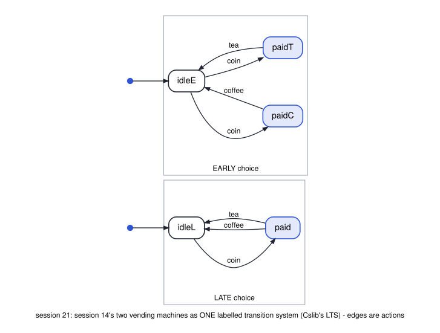
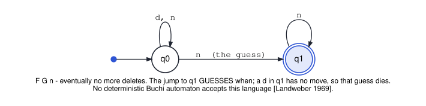

# cs3892-2026-11-10-cslib-machine-checked-foundations

Session 21 (a guest lecture). **Cslib** is Lean's library for computer science, built on Mathlib.
At the course pin, **v4.33.0**, it proves results from sessions 12 and 14: the Hennessy–Milner
theorem (same HML formulas iff bisimilar, for image-finite systems), that trace equivalence is
strictly coarser than bisimilarity, the Büchi intersection construction, that some ω-regular
language has no deterministic Büchi automaton, and that ω-regular languages are closed under
complement. As of v4.33.0 it has **no LTL**, no LTL → Büchi translation, and no emptiness decision
procedure: the model-checking pipeline of session 12 is only partly machine-checked.

**Not for Colab: this needs Mathlib.** The first build fetches Mathlib's prebuilt cache (`lake exe
cache get`, about 1.5 minutes and **7.5 GB** under `lean/.lake`) and compiles only the Cslib modules
it imports (about 1 minute on a 24-core machine; expect several minutes on a laptop). Run it
locally or in a Codespace with that much disk, or just read the outputs below: nothing graded
needs it. The default CI jobs skip this folder (`HEAVY`); `.github/workflows/cslib.yml` runs it.

| File | Shows | Result |
|---|---|---|
| `python/lean_cli.py` | finds Lean v4.33.0 (HW4's installer), fetches the Mathlib cache, builds, runs a file through `lake env lean`, reads goals | `Lean (version 4.33.0, …)` |
| `lean/S21/Vending.lean`, `python/01_vending_hml.py` | session 14's two vending machines as one Cslib LTS; the HML formula ⟨coin⟩¬⟨tea⟩⊤ holds at `idleE` and not at `idleL`; so, by Hennessy–Milner, not bisimilar | `not_bisimilar`: `[propext, Classical.choice, Quot.sound]` |
| `lean/S21/Results.lean`, `python/02_hennessy_milner.py` | `#check` of `theoryEq_eq_bisimilarity` and `bisimilarity_neq_traceEq` | `TheoryEq lts = lts.HomBisimilarity` · `∃ … HomBisimilarity ≠ HomTraceEq` |
| `lean/S21/Results.lean`, `python/03_buchi.py` | `#check` and `#print axioms` of `inter_language_eq`, `IsRegular.not_da_buchi`, `IsRegular.compl` | all three on the standard axioms |
| `lean/S21.lean`, `python/04_whole_library.py` | `lake exe cache get`, `lake build` | builds, no `sorry`, no warning |

Nothing here proves a result about Cslib's automata ourselves: `Results.lean` reads Cslib's own
theorems. `Vending.lean` is the one proof, and it uses Cslib's Hennessy–Milner theorem.





Run them all (this one must be named; the default run skips it):

```bash
bash scripts/check_examples.sh sessions/cs3892-2026-11-10-cslib-machine-checked-foundations
```
