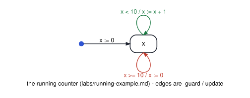

# cs3892-2026-12-03-ai-for-formal-methods

Session 26 (after D9): AI for formal methods. An LLM writes the specification, or the proof, and a
tool decides. Two real runs of Claude Haiku 4.5 (no tools, an empty directory, saved verbatim in
`llm/`; see `llm/run.md`), each checked by a tool the course already uses.

| File | Shows | Result |
|---|---|---|
| `python/nusmv.py` | finds NuSMV, or fetches FBK's build (2.7.1, else the static 2.6.0); runs a model; reads verdicts | — |
| `smv/counter.smv`, `smv/free.smv`, `python/01_llm_ltl.py` | four English requirements of the running counter → LTL by the LLM; checked three ways: syntax, truth on the counter, and equivalence with a reference on a free model | NuSMV rejects the lines as written (`//` comments); all four hold on the counter; R4 is a **different** property from the reference (weak vs strong "only after"), with NuSMV's counterexample |
| `lean/S26/Sum.lean`, `python/02_llm_lean.py`, `python/lean_cli.py` | `2 * sumTo n = n * (n + 1)` in core Lean: the LLM's two rounds, judged by Lean; a proof Lean accepts | round 1: ``Unknown identifier `mul_add` `` (a Mathlib name); round 2: `omega could not prove the goal`; `grind` proves it |



Run them all:

```bash
bash scripts/check_examples.sh sessions/cs3892-2026-12-03-ai-for-formal-methods
```
